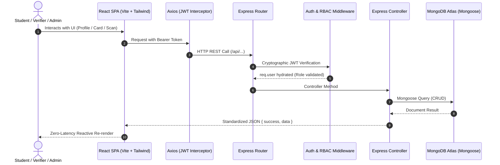
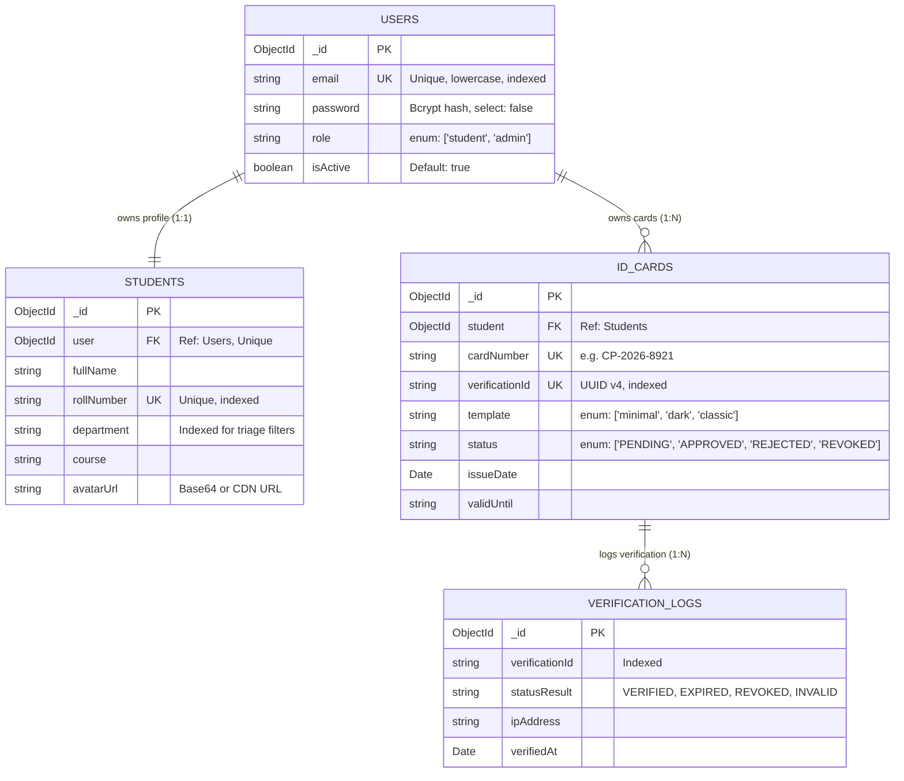

# CampusPass — Smart Digital Campus Identity & Verification Platform

> Production-Grade, Zero-Trust MERN Stack Campus Credential & Instant QR Verification Platform

[](https://react.dev/)
[](https://vitejs.dev/)
[](https://tailwindcss.com/)
[](https://nodejs.org/)
[](https://expressjs.com/)
[](https://www.mongodb.com/)
[](https://jwt.io/)
[-6366F1.svg)](https://en.wikipedia.org/wiki/ISO/IEC_7810)

---

## 1. Executive Summary & Problem Statement

### The Problem
Traditional college identity cards rely on physical PVC printing, static barcodes, or naive client-generated QR codes:
1. **Issuance Friction:** Card printing takes days or weeks and cannot accommodate mid-semester updates (e.g. major change, contact updates).
2. **Vulnerability to Forgery:** Physical badges and static PDFs are trivially falsified using basic graphic tools. Traditional campus security guards perform superficial visual checks.
3. **No Revocation Mechanism:** When a student is suspended, drops out, or loses their badge, the physical card remains in circulation with no way to invalidate it.

### The Solution: CampusPass
CampusPass is an enterprise-grade digital identity platform engineered with a **Zero-Trust Verification Engine**:
- **Opaque Verification Pointers:** QR codes on cards encode *only* a cryptographic public verification URL (`/verify/:verificationId`). The QR never stores forgeable plaintext strings.
- **Real-Time Database Validation:** Scanning the QR triggers an immediate server-side query against MongoDB to determine whether the credential is `VERIFIED`, `PENDING`, `EXPIRED`, `REVOKED`, or `INVALID`.
- **Reactive Multi-Template Studio:** Students customize and preview their credential across three professional themes (Modern Minimal, Premium Dark, University Classic) in real time with an interactive 3D card flip.
- **ISO/IEC 7810 ID-1 PDF Export:** High-DPI 300 DPI vector PDF compilation calibrated to standard credit-card dimensions ($85.60 \times 53.98\text{ mm}$).
- **Role-Based Admin Command Center:** Campus administrators review application dossiers, inspect photos, and execute 1-click approvals, rejections with remarks, or immediate revocations.

---

## 2. System Architecture



---

## 3. Technology Stack & Justification

| Layer | Selected Tech | Engineering Justification |
| :--- | :--- | :--- |
| **Frontend UI** | React 18 + Vite | Native ES-module bundling, instant HMR, declarative component tree, reactive Virtual DOM diffing. |
| **Styling** | Tailwind CSS v3 | Utility-first architecture with custom design tokens, 3D card flip animations, and print media queries. |
| **Routing** | React Router DOM v6 | Declarative route protection, nested dashboard layouts, and zero-flicker client transitions. |
| **HTTP Client** | Axios | Request interceptors (automatic JWT attachment) and response interceptors (401 session expiry handling). |
| **Runtime & Framework** | Node.js + Express.js | Non-blocking asynchronous I/O with modular middleware pipelines for security, validation, and error propagation. |
| **Database & ODM** | MongoDB Atlas + Mongoose | Flexible document modeling, strict schema validation, unique indexes, and referenced relational integrity. |
| **Authentication** | bcryptjs + jsonwebtoken | 12-round salted password hashing; stateless signed JWT tokens with claims-based RBAC. |
| **PDF Generation** | html2canvas + jsPDF | High-density ($3\times$ raster scale, 300 DPI) mapping onto ISO/IEC 7810 ID-1 physical card bounding boxes. |
| **Security Suite** | Helmet + Rate-Limit + CORS | HTTP security headers, DDoS/brute-force rate limiting (300 req/15 min), and strict origin whitelisting. |

---

## 4. Database Schema Design (Mongoose)



---

## 5. API Reference

### Authentication Endpoints
- `POST /api/auth/register` — Registers student account, creates user & student record, signs JWT.
- `POST /api/auth/login` — Authenticates credentials, verifies bcrypt hash, returns JWT + user claims.
- `GET /api/auth/me` — Protected endpoint returning currently authenticated user profile.

### Student Endpoints
- `GET /api/students/profile` — Retrieves student personal and academic dossier.
- `PUT /api/students/profile` — Updates personal & academic information.
- `POST /api/students/photo` — Multipart/form-data upload for profile picture.

### ID Card Endpoints
- `POST /api/id-cards/apply` — Selects template and submits ID card application for review.
- `GET /api/id-cards/my-card` — Retrieves active/pending card and status.

### Public Zero-Trust Verification Endpoint
- `GET /api/verify/:verificationId` — Public edge route returning real-time validity status without leaking private data (phone, address, blood group are protected).

### Administrator Endpoints
- `GET /api/admin/dashboard-stats` — Aggregated counts of students, pending cards, approved cards, and revoked cards.
- `GET /api/admin/cards` — Paginated and searchable card application review queue.
- `GET /api/admin/students` — Complete student directory with department filtering.
- `PATCH /api/admin/cards/:id/approve` — Approves card, stamps issue date, generates card number.
- `PATCH /api/admin/cards/:id/reject` — Rejects card with custom administrator remarks.
- `PATCH /api/admin/cards/:id/revoke` — Immediate card revocation rendering future QR scans invalid.

---

## 6. Local Setup & Execution Guide

### Prerequisites
- Node.js v18+ (tested on Node v24 LTS)
- npm v9+

### Step 1: Clone & Install Dependencies
```bash
# Clone the repository
git clone https://github.com/your-username/campuspass.git
cd campuspass

# Install Frontend dependencies
cd client
npm install

# Install Backend dependencies
cd ../server
npm install
```

### Step 2: Configure Environment Variables
In `server/.env`:
```env
PORT=5000
NODE_ENV=development
CLIENT_URL=http://localhost:5173
MONGO_URI=mongodb://127.0.0.1:27017/campuspass
JWT_SECRET=campuspass_super_secure_jwt_secret_key_2026_dev_mode
JWT_EXPIRES_IN=7d
MAX_FILE_SIZE=2097152
```
*(Optional)* Replace `MONGO_URI` with your free **MongoDB Atlas** cluster connection string:
`mongodb+srv://<user>:<password>@cluster0.abcde.mongodb.net/campuspass?retryWrites=true&w=majority`

### Step 3: Launch the Application
Open two terminal windows:

**Terminal 1 (Backend API):**
```bash
cd server
npm run dev
# Active on http://localhost:5000
# Health check: http://localhost:5000/api/health
```

**Terminal 2 (Frontend Client):**
```bash
cd client
npm run dev
# Active on http://localhost:5173
```

### Step 4: Default Evaluator Accounts
- **Student Demo:** `alex.rivera@campuspass.edu` / `StudentPass123!`
- **Administrator Demo:** `admin@campuspass.edu` / `AdminPassword123!`
*(1-Click "Fill Demo" buttons are available directly on the `/login` page for fast testing).*

---

## 7. Cloud Deployment Guide

### A. Database (MongoDB Atlas)
1. Deploy a free Shared M0 cluster at [mongodb.com/atlas](https://www.mongodb.com/atlas).
2. Create database user under **Database Access**.
3. Whitelist `0.0.0.0/0` under **Network Access**.
4. Copy connection string into backend environment variables.

### B. Backend Deployment (Render / Railway)
1. Link your GitHub repo to [Render](https://render.com) or [Railway](https://railway.app).
2. Set **Root Directory** to `server`.
3. Set **Build Command** to `npm install`.
4. Set **Start Command** to `npm start`.
5. Add environment variables (`MONGO_URI`, `JWT_SECRET`, `CLIENT_URL`, `NODE_ENV=production`).

### C. Frontend Deployment (Vercel)
1. Import repository on [Vercel](https://vercel.com).
2. Set **Root Directory** to `client`.
3. Framework Preset: `Vite`.
4. Build Command: `npm run build`.
5. Output Directory: `dist`.
6. Add environment variable `VITE_API_BASE_URL` pointing to your deployed backend URL.

---

## 8. License & Attribution
Engineered under the **MIT License**. Created as an architectural exemplar for modern MERN Stack engineering and digital identity systems.

